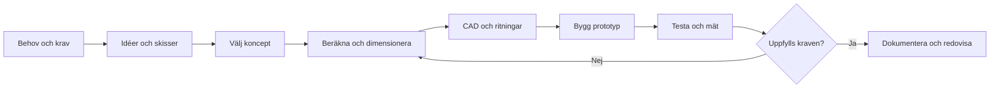

# Kapitel 1: Konstruktionsprocessen

> **I det här kapitlet lär du dig**
> - vilka steg en konstruktion går igenom från idé till färdig produkt
> - hur du skriver krav som går att kontrollera
> - hur du väljer mellan flera koncept med en beslutsmatris
> - vilka faktorer som påverkar hur en produkt utformas

En konstruktör sitter sällan och får en genial idé som sedan bara ska byggas. Det vanliga är att någon har ett problem, att du undersöker vad lösningen måste klara, att du provar flera idéer och att den första versionen inte fungerar. Skillnaden mellan en bra och en dålig konstruktion ligger ofta i hur arbetet gick till. I det här kapitlet går vi igenom arbetssättet som du använder i alla kursens projekt.

## Från behov till färdig produkt

**Konstruktionsprocessen** är det arbetssätt som leder från ett behov till en produkt som fungerar. Stegen brukar vara desamma även om namnen varierar mellan företag.

Lägg märke till pilen tillbaka från testet. Den kallas **iteration**: du går tillbaka, ändrar något och provar igen. Att behöva iterera betyder inte att du misslyckats. Det är så konstruktioner blir bra.

Stegen hänger också ihop bakåt. Ett materialval i CAD-steget kan ändra dina beräkningar, och ett mått du tvingas ändra i verkstaden måste föras tillbaka in i modellen. Därför säger man att stegen samverkar. Det är den samverkan du ska kunna visa i dina projekt.

## Krav som går att kontrollera

En **kravspecifikation** är en lista över vad lösningen måste klara. Ett bra krav går att testa i efterhand. Jämför:

| Otydligt krav | Krav som går att kontrollera |
|---|---|
| Ställningen ska vara hög nog | Markfrigången ska vara minst 100 mm |
| Kastet ska gå långt | Medelvärdet av fem kast ska nå ett bestämt antal meter som ni har valt |
| Projektet ska vara billigt | Materialkostnaden får vara högst 250 kr |

Skilj på **måste-krav** och **önskemål**. Måste-kraven ska alla uppfyllas, annars är lösningen inte godkänd. Önskemål är sådant du väger mot varandra när du väljer lösning. Krav kan handla om funktion, mått, vikt, kostnad, säkerhet, miljö och tillverkning.

## Idéer och koncept

När kraven är klara tar du fram flera idéer innan du fastnar för en. Ett vanligt fel är att bygga den första idé som dök upp. Skissa snabbt och utan att värdera, gärna tillsammans i gruppen. Det kallas **brainstorming**. Sortera sedan idéerna och välj ut några **koncept**, alltså principlösningar som beskriver hur produkten i stora drag ska fungera.

### Exempel: välj koncept med beslutsmatris

En grupp ska bygga en katapult och har tre koncept. De har bestämt fyra kriterier och gett varje kriterium en vikt som visar hur viktigt det är. Varje koncept får sedan 1–5 poäng per kriterium. Poängen multipliceras med vikten och summeras. Poängen är gruppens egna bedömningar och de är påhittade för exemplet.

| Kriterium | Vikt | A: motvikt | B: vridarm med gummi | C: spännband i ram |
|---|---|---|---|---|
| Kastlängd | 3 | 3 → 9 | 4 → 12 | 5 → 15 |
| Träffsäkerhet | 4 | 4 → 16 | 3 → 12 | 2 → 8 |
| Enkel att bygga | 2 | 3 → 6 | 4 → 8 | 2 → 4 |
| Säker att använda | 3 | 4 → 12 | 2 → 6 | 2 → 6 |
| **Summa** |  | **43** | **38** | **33** |

Koncept A vinner. Matrisen beslutar inte åt er, men den tvingar er att säga varför ni tycker som ni gör. Om ni ändrar vikterna en aning och en annan lösning vinner, då är valet jämnt och kan avgöras av något annat, till exempel vilket material ni har tillgång till.

## Faktorer som påverkar utformningen

En produkt formas av mer än funktionen. Tänk igenom följande när du tar fram ett koncept:

- **Miljö:** Vilka material används, hur mycket går åt, går produkten att reparera och återvinna?
- **Säkerhet:** Kan någon skadas under bygge, användning eller om produkten går sönder? En katapult med en arm som slår till behöver ett område där ingen står.
- **Digitalisering:** Sensorer, styrning och uppkopplade funktioner ändrar vad en produkt kan göra. De ändrar också vad som kan gå fel, till exempel om uppkopplingen tappas.
- **Ekonomi och tillverkning:** Vad kostar materialet, och går delarna att tillverka med de verktyg som finns?

Ofta står faktorerna mot varandra. En lättare konstruktion sparar energi vid användning men kan kräva ett material som är dyrare och kostar mer energi att framställa. Sådana val har en etisk sida: vem betalar priset för att produkten blir billig, och vad händer med den när den är uttjänt? Som konstruktör bestämmer du tidigt en stor del av produktens miljöpåverkan, eftersom materialval och form sällan ändras senare.

## Metoder att konstruera

Det finns olika sätt att närma sig en konstruktion. Tre metoder möter du i kursen:

| Metod | Vad den innebär | Exempel i kursen |
|---|---|---|
| Beräkningsdriven | Räkna ut huvudmåtten först och modellera sedan | Katapultens hävarm och kastbana |
| Modulär | Bygg av färdiga standardkomponenter | Smådjursställning av aluminiumprofiler |
| Experimentell | Prova, mät och ändra steg för steg | Inmatningen i Sort My Brick |

Bra konstruktörer blandar metoderna. Beräkning sparar tid genom att sortera bort lösningar som aldrig kan fungera, medan experiment hittar problem som ingen modell förutsåg.

## Dokumentera från första dagen

Skriv ner vad ni gör medan ni gör det. En skiss med datum och några ord om varför idén valdes bort är värd mer än ett försök att minnas i efterhand. Hur en bra dokumentation ser ut går vi igenom i [kapitel 10](10-prototyp-komponenter-dokumentation.md).

## Begrepp

- **Konstruktionsprocessen:** arbetssättet från behov och krav till färdig, testad produkt.
- **Kravspecifikation:** lista över det lösningen ska klara, skriven så att det går att kontrollera.
- **Koncept:** principlösning som beskriver hur produkten i stort ska fungera.
- **Beslutsmatris:** tabell där koncept poängsätts efter viktade kriterier.
- **Iteration:** att gå tillbaka, ändra och prova igen.
- **Prototyp:** första fysiska versionen som används för att testa en lösning.

## Koppling till projektet

Hela processen använder du i [Katapult](../projekt/katapult/README.md), där du går från skisser och beslutsmatris till bygge och test. Samma arbetssätt återkommer i [Bygg 2.0](../projekt/bygg-2-0/README.md), [Robotmopp](../projekt/robotmopp/README.md) och [Sort My Brick](../projekt/sort-my-brick/README.md).

## Läs mer

- [Beslutsmatris (Wikipedia, engelska)](https://en.wikipedia.org/wiki/Decision_matrix)
- [Livscykelanalys (Wikipedia, engelska)](https://en.wikipedia.org/wiki/Life-cycle_assessment)

[Innehåll](../README.md) | [Nästa →](02-moment-energi-kastbana.md)
