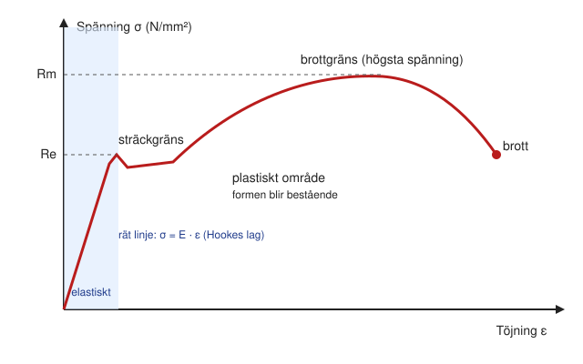

# Kapitel 6: Drag, tryck och Hookes lag

> **I det här kapitlet lär du dig**
> - vad mekanisk spänning är och hur du räknar ut den
> - vad töjning är och hur du beräknar förlängning
> - hur du läser en dragprovkurva och förstår Re, Rm och Rp0,2
> - hur du använder Hookes lag och elasticitetsmodulen

Hållfasthetslära handlar om att ta reda på om en detalj håller, innan du gör den. Du börjar med de enklaste fallen: en stång som dras eller trycks längs sin längdriktning. Tänk på en cykelkedja, en lina i en lyftkran eller en pelare som bär ett tak. Att bestämma hur stor en detalj behöver vara för att klara sin last kallas att **dimensionera** den.

## Mekanisk spänning

Du kan knappast säga om en 5000 N stor kraft är mycket för en stång utan att veta hur grov stången är. Därför räknar man inte på kraften, utan på kraften per ytenhet. Det kallas **mekanisk spänning** eller påkänning.

```text
σ = F / A

σ  (sigma)  spänning i N/mm²
F           kraft i N
A           tvärsnittsarea i mm²
```

Enheten N/mm² är samma sak som MPa. **Tvärsnittsarean** är den area du ser om du kapar stången rakt över. Några vanliga tvärsnitt:

```text
Kvadrat:      A = s²
Rektangel:    A = b · h
Cirkel:       A = π · d² / 4
Rör:          A = π · (D² - d²) / 4
```

I hållfasthetslära räknar man i regel med krafter i N och mått i mm. Då blir spänningen direkt i N/mm². Blanda inte meter och millimeter i samma formel.

### Exempel: dragspänning i en rundstång

En rundstång med diametern 10 mm belastas med dragkraften 12 kN. Beräkna spänningen.

```text
Givet:  d = 10 mm, F = 12 000 N
Sökt:   σ

A = π · 10² / 4 = 78,5 mm²
σ = F / A = 12 000 / 78,5 = 153 N/mm²

Svar: spänningen är ungefär 153 N/mm².
```

### Exempel: tryck i ett rör

Ett stålrör med ytterdiametern 60 mm och godstjockleken 4 mm trycks ihop med 30 kN.

```text
Innerdiameter: d = 60 - 2 · 4 = 52 mm
A = π · (60² - 52²) / 4 = 704 mm²
σ = 30 000 / 704 = 42,6 N/mm²
```

Vid tryck finns ett extra problem: långa och slanka detaljer kan **knäcka**, alltså plötsligt böja ut åt sidan, långt innan spänningen når materialets gräns. Vi räknar inte på knäckning i den här kursen, men tänk på det när en lång, smal pelare bär tryck.

## Töjning

När du drar i en stång blir den längre. **Töjning** är förlängningen jämfört med ursprungslängden.

```text
ε = ΔL / L0

ε (epsilon)  töjning, ingen enhet (anges ibland i procent)
ΔL           förlängningen
L0           ursprungslängden
```

### Exempel: töjning

En 2,0 m lång tråd förlängs 1,2 mm när den belastas.

```text
ε = 1,2 / 2000 = 0,0006     (vilket är 0,06 %)
```

## Dragprovet

Det vanligaste sättet att ta reda på hur starkt ett material är kallas **dragprov**. En provstav spänns fast i en maskin och dras långsamt tills den går av. Under tiden mäts kraft och förlängning. Delar du kraften med stavens ursprungsarea och förlängningen med dess ursprungslängd får du en kurva över spänning mot töjning.



Kurvan för ett konstruktionsstål har tydliga delar:

- **Elastiska området.** Kurvan är en rät linje. Tar du bort lasten återgår staven till sin ursprungsform, som en fjäder.
- **Sträckgräns Re.** Här börjar materialet ändra sig bestående, och det kallas att gå över till det **plastiska området**. En detalj får oftast inte belastas förbi sträckgränsen.
- **Brottgräns Rm.** Kurvans högsta punkt, den största spänning materialet tål.
- **Brott.** Staven snörs av och går av.

Vissa material, till exempel aluminium, har ingen tydlig sträckgräns. Då använder man **Rp0,2**, den spänning som lämnar en kvarstående töjning på 0,2 %.

Hur du använder Re och Rm för att bedöma säkerheten kommer i nästa kapitel.

## Hookes lag

Den raka delen av kurvan kan skrivas som en enkel formel. Sambandet kallas **Hookes lag** efter den engelske vetenskapsmannen Robert Hooke.

```text
σ = E · ε

E  elasticitetsmodul i N/mm²
```

**Elasticitetsmodulen** E är en materialkonstant som talar om hur styvt materialet är. Stål har ungefär 210 000 N/mm² och aluminium ungefär 69 000 N/mm². Lagen gäller bara i det elastiska området.

Kombinerar du σ = F/A, ε = ΔL/L0 och Hookes lag får du en formel för förlängning:

```text
ΔL = F · L0 / (A · E)
```

### Exempel: hur mycket förlängs en aluminiumstång?

En aluminiumstång med diametern 12 mm och längden 1500 mm belastas med 5,0 kN. E = 69 000 N/mm².

```text
A = π · 12² / 4 = 113 mm²
σ = 5000 / 113 = 44,2 N/mm²
ε = σ / E = 44,2 / 69 000 = 0,00064
ΔL = ε · L0 = 0,00064 · 1500 = 0,96 mm
```

### Exempel: E-modul från ett dragprov

En provstav har A0 = 50 mm² och L0 = 50 mm. Vid 15 kN är förlängningen 0,072 mm, och vi befinner oss på kurvans raka del.

```text
σ = 15 000 / 50 = 300 N/mm²
ε = 0,072 / 50 = 0,00144
E = σ / ε = 300 / 0,00144 = 208 000 N/mm²
```

Värdet ligger nära det som gäller för stål, så provstaven är sannolikt av stål. Rimlighetsbedömning är en del av beräkningen.

## Begrepp

- **Dimensionera:** bestämma hur stor en detalj måste vara för att klara sin belastning.
- **Spänning σ:** kraft per ytenhet, F / A.
- **Tvärsnittsarea:** arean av ett tänkt snitt rakt över en detalj.
- **Töjning ε:** förlängning i förhållande till ursprungslängd.
- **Sträckgräns Re:** spänningen där materialet börjar deformeras bestående.
- **Brottgräns Rm:** den högsta spänning materialet klarar.
- **Rp0,2:** spänningen som ger 0,2 % kvarstående töjning.
- **Elasticitetsmodul E:** materialkonstant som beskriver styvhet.
- **Hookes lag:** σ = E · ε, gäller i det elastiska området.

## Testa dig själv

1. Varför räknar man på spänning i stället för bara på kraft?
2. Vad betyder det att ε saknar enhet?
3. Vad händer med en stålstav om du belastar den över Re och sedan släpper?
4. Varför använder man Rp0,2 för aluminium?
5. Vad talar elasticitetsmodulen om för dig?
6. Varför får Hookes lag bara användas i det elastiska området?
7. Vilket problem kan uppstå för en lång, tunn pelare som belastas med tryck?

## Övningar

**Grund 1.** En stång med rektangulärt tvärsnitt 12 × 20 mm belastas med 18 kN. Beräkna spänningen.

<details><summary>Svar</summary>

75 N/mm²

</details>

**Grund 2.** En tråd med diametern 6 mm belastas med 2,5 kN. Beräkna spänningen.

<details><summary>Svar</summary>

88 N/mm²

</details>

**Grund 3.** En 3 m lång stång förlängs 1,5 mm. Vad är töjningen?

<details><summary>Svar</summary>

0,0005 (0,05 %)

</details>

**Vidare 4.** En stång med diametern 16 mm tål spänningen 120 N/mm². Vilken är den största kraft den kan belastas med?

<details><summary>Svar</summary>

F = σ · A = 120 · 201 = 24,1 kN

</details>

**Vidare 5.** En ståltråd med diametern 2 mm är 3 m lång och belastas med 300 N. Beräkna spänning och förlängning. E = 210 000 N/mm².

<details><summary>Svar</summary>

σ = 95,5 N/mm². ΔL = 1,36 mm.

</details>

**Utmaning 6.** En aluminiumstång ska bära 9 kN med högst 0,1 % töjning. Vilken minsta diameter krävs? E = 69 000 N/mm².

<details><summary>Svar</summary>

σ = E · ε = 69 N/mm². A = 9000 / 69 = 130,4 mm². d = 12,9 mm.

</details>

Räkna också övningsuppgifterna under avsnitten om mekanisk spänning, dragprov och Hookes lag i [kompendiet](../H%C3%A5llfasthetsl%C3%A4ra/02.%20H%C3%A5llfasthetsl%C3%A4ra%20kompendium.docx).

## Koppling till projektet

Kapitlet täcker första delen av momentet [Hållfasthetslära](../projekt/hallfasthetslara/README.md). Stödet för lektionerna finns i filmerna [Intro](../H%C3%A5llfasthetsl%C3%A4ra/01.%20H%C3%A5llfasthetsl%C3%A4ra%20intro.mp4) och [Del 2: dragprov, töjning](../H%C3%A5llfasthetsl%C3%A4ra/06.%20H%C3%A5llf%20del%202%2C%20dragprov%2C%20t%C3%B6jning%20mm.mp4). Lösningar till kompendiet finns i [Lösningar 1-47](../H%C3%A5llfasthetsl%C3%A4ra/L%C3%B6sningar%201-47.pdf).

## Läs mer

- [Hookes lag (Wikipedia, engelska)](https://en.wikipedia.org/wiki/Hooke%27s_law)
- [Elasticitetsmodul (Wikipedia)](https://sv.wikipedia.org/wiki/Elasticitetsmodul)
- [Sträckgräns (Wikipedia)](https://sv.wikipedia.org/wiki/Str%C3%A4ckgr%C3%A4ns)

[← Föregående](05-material-och-materialval.md) | [Innehåll](../README.md) | [Nästa →](07-sakerhetsfaktor-skjuvning.md)
