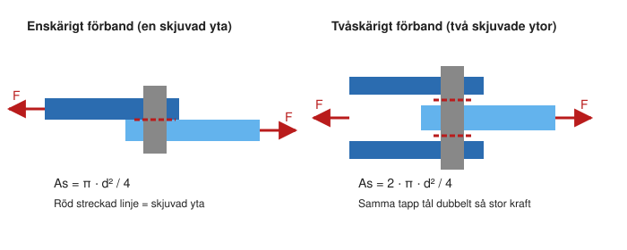

# Kapitel 7: Säkerhetsfaktor och skjuvning

> **I det här kapitlet lär du dig**
> - varför konstruktioner dimensioneras med säkerhetsfaktorer
> - hur du räknar ut sträcksäkerhet och brottsäkerhet
> - hur du dimensionerar en detalj för drag eller tryck
> - vad skjuvning är och hur du räknar på limfogar och nitar

Du vet nu hur stor spänningen blir i en detalj. Men är den spänningen för stor? Du behöver kunna jämföra med vad materialet klarar. Det gör du med en säkerhetsfaktor. I samma kapitel lär du dig en ny typ av belastning, skjuvning, som uppstår i till exempel skruvförband och limfogar.

## Varför säkerhetsfaktor?

Du vet inte exakt hur stora krafterna blir. Materialet har inte exakt det värde som står i tabellen. En last kan komma med en stöt, och detaljen kan slitas med tiden. Därför konstruerar man inte så att spänningen precis når materialets gräns.

**Säkerhetsfaktorn** anger hur många gånger större materialets gräns är än den spänning som uppstår:

```text
Sträcksäkerhet:   nS = Re / σ       (marginal mot bestående deformation)
Brottsäkerhet:    nB = Rm / σ       (marginal mot brott)
```

Vilken säkerhet som krävs beror på hur farlig en skada skulle bli, hur väl du känner lasterna och vilka krav som ställs. En lyftanordning som bär människor behöver helt andra marginaler än en hållare på ett skrivbord. Säkerhetsfaktorn ges i uppgiften, följer av normer eller väljs utifrån erfarenhet.

En säkerhetsfaktor på 3 betyder inte att du kan belasta en detalj tre gånger hårdare utan problem. Slitage, stötar och utmattning kan göra att marginalen i verkligheten blir mindre. Det är därför man har marginalen.

Med ett önskat säkerhetstal får du den **tillåtna spänningen**:

```text
σtill = Re / nS
```

## Hur man dimensionerar

Att dimensionera går alltid till på samma sätt:


### Exempel: kontrollera ett stag

Ett stag med diametern 12 mm i S235 belastas med 10 kN. Använd Re = 235 N/mm² och Rm = 360 N/mm², som är det lägsta värdet.

```text
A = π · 12² / 4 = 113,1 mm²
σ = 10 000 / 113,1 = 88,4 N/mm²
nS = 235 / 88,4 = 2,7
nB = 360 / 88,4 = 4,1
```

### Exempel: dimensionera ett stag

Ett runt dragstag ska bära 8,0 kN. Material S235 och nS = 2,5. Vilken diameter behövs?

```text
σtill = 235 / 2,5 = 94 N/mm²
A = 8000 / 94 = 85,1 mm²
d = √(4 · A / π) = 10,4 mm
```

Du väljer närmast större standardmått, till exempel 12 mm. Kontrollera sedan:

```text
σ = 8000 / (π · 12² / 4) = 70,7 N/mm²
nS = 235 / 70,7 = 3,3
```

Det valda måttet ger högre säkerhet än det krävda, vilket är precis vad du vill.

## Skjuvning

Vid drag och tryck är spänningen vinkelrät mot ytan. Den kallas **normalspänning**. I andra fall verkar krafterna parallellt med ytan, som när en sax klipper ett papper. Då uppstår **skjuvspänning**.

```text
τ = F / As

τ (tau)   skjuvspänning i N/mm²
As        skjuvad area i mm²
```

Att hitta rätt yta är det svåra. Fråga dig vilken yta som skulle gå av.



| Fall | Skjuvad yta |
|---|---|
| Limfog med bredden B och längden L | As = B · L |
| Nit eller tapp, enskärigt förband | As = π · d² / 4 |
| Nit eller tapp, tvåskärigt förband | As = 2 · π · d² / 4 |

Skjuvhållfastheten är lägre än draghållfastheten. Till dimensionering använder vi den regel som står i kompendiet:

```text
τtill = 0,6 · σtill
```

Regeln gäller bara när du utgår från ett tillåtet dragvärde. Ges ett tillåtet skjuvvärde direkt i uppgiften använder du det utan någon faktor 0,6.

### Exempel: limfog

Två plåtar överlappar 30 mm i bredd och 40 mm i längd och belastas med 4,0 kN.

```text
As = 30 · 40 = 1200 mm²
τ = 4000 / 1200 = 3,3 N/mm²
```

### Exempel: tapp i ett tvåskärigt förband

Katapultens axel sitter i två lagerbockar och är en tapp med diametern 8 mm i S235. Kraften från armen är 3,0 kN.

```text
As = 2 · π · 8² / 4 = 100,5 mm²
τ = 3000 / 100,5 = 29,8 N/mm²

Med nS = 2,5:
τtill = 0,6 · 235 / 2,5 = 56,4 N/mm²     (29,8 < 56,4, tappen håller)
Verklig säkerhet: 0,6 · 235 / 29,8 = 4,7
```

### Exempel: dimensionera en tapp i ett enskärigt förband

Ett enskärigt förband ska ta upp 6,0 kN. Tappen ska göras av ett stål med Re = 320 N/mm², och nS = 2.

```text
τtill = 0,6 · 320 / 2 = 96 N/mm²
As = 6000 / 96 = 62,5 mm²
d = √(4 · 62,5 / π) = 8,9 mm     → välj till exempel 10 mm
```

## Begrepp

- **Säkerhetsfaktor:** kvot som visar hur stor marginal det finns mot en materialgräns.
- **Sträcksäkerhet nS:** Re delat med den aktuella spänningen.
- **Brottsäkerhet nB:** Rm delat med den aktuella spänningen.
- **Tillåten spänning σtill:** den största spänning som får uppstå med vald säkerhet.
- **Normalspänning:** spänning vinkelrät mot ytan.
- **Skjuvspänning τ:** spänning parallell med ytan.
- **Enskärigt/tvåskärigt förband:** förband där ett respektive två tvärsnitt skjuvas.

## Koppling till projektet

Kapitlet hör till momentet [Hållfasthetslära](../projekt/hallfasthetslara/README.md). Se filmen [Lektion 3: säkerhetsfaktor](../H%C3%A5llfasthetsl%C3%A4ra/07.%20H%C3%A5llf%20lektion%203%2C%20s%C3%A4kerhetsfaktor%20mm.mp4). Skjuvning återkommer när du dimensionerar axeln i [Katapult](../projekt/katapult/README.md).

## Läs mer

- [Säkerhetsfaktor (Wikipedia, engelska)](https://en.wikipedia.org/wiki/Factor_of_safety)
- [Skjuvning (Wikipedia)](https://sv.wikipedia.org/wiki/Skjuvning)
- [Skjuvspänning (Wikipedia, engelska)](https://en.wikipedia.org/wiki/Shear_stress)

[← Föregående](06-drag-tryck-hookes-lag.md) | [Innehåll](../README.md) | [Nästa →](08-bojning.md)
