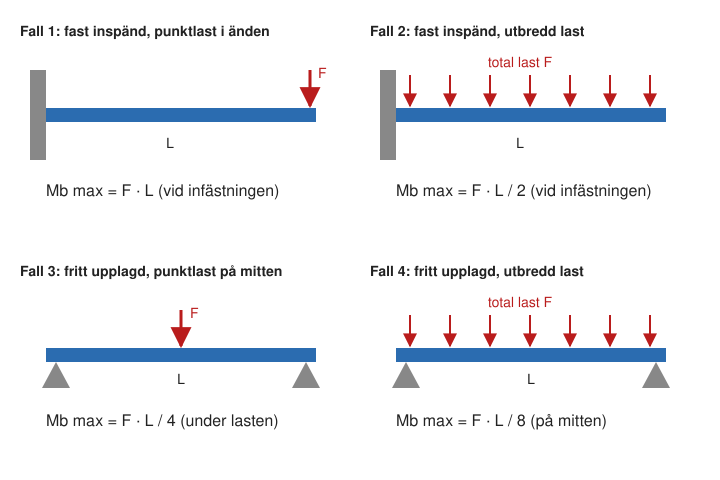

# Kapitel 8: Böjning

> **I det här kapitlet lär du dig**
> - hur spänningarna fördelas i en balk som böjs
> - hur du beräknar böjmotstånd för vanliga tvärsnitt
> - hur du räknar ut största böjmoment med de fyra enkla belastningsfallen
> - hur du dimensionerar en balk och räknar på godtyckliga laster

Stå på en trampolin, häng en skylt på en vägg eller lägg en tung bok på en hylla. Allt detta orsakar böjning, som är ett av de vanligaste belastningsfallen i konstruktioner. Böjning förklarar också varför en planka är så mycket styvare om du ställer den på högkant.

## Spänningar i en balk

När en balk böjs förlängs ena sidan och andra sidan trycks ihop. Enligt Hookes lag uppstår alltså dragspänning på ena sidan och tryckspänning på den andra. Mitt emellan finns ett plan där spänningen är noll, **neutrala lagret**. Spänningen ökar rätlinjigt ju längre bort från neutrala lagret du kommer och är störst i ytterkanterna.

Det är därför materialet i ytterkanterna gör mest nytta. Ett rör eller en I-balk har placerat materialet just där det behövs, medan materialet i mitten nästan inte bidrar.

## Spänningslagen för böjning

```text
σb = Mb / Wb

σb   böjspänning i N/mm²
Mb   böjmoment i Nmm
Wb   böjmotstånd i mm³
```

Var noga med enheterna. Mb räknas ofta i Nm, men måste skrivas om till Nmm (1 Nm = 1000 Nmm) när Wb anges i mm³.

**Böjmotståndet** Wb beror bara på tvärsnittets form:

| Tvärsnitt | Böjmotstånd Wb |
|---|---|
| Rektangel, bredd b, höjd h | b · h² / 6 |
| Cirkel, diameter d | π · d³ / 32 |
| Rör, ytter D, inner d | π · (D⁴ − d⁴) / (32 · D) |

Lägg märke till att höjden är i kvadrat. En rektangel på högkant har större Wb än samma rektangel lagd platt.

## De fyra enkla belastningsfallen

Med de fyra fallen nedan klarar du de flesta uppgifterna. Här är F den totala lasten och L balkens längd.



| Fall | Beskrivning | Största Mb | Var? |
|---|---|---|---|
| 1 | Fast inspänd, punktlast i änden | F · L | Vid infästningen |
| 2 | Fast inspänd, jämnt utbredd last | F · L / 2 | Vid infästningen |
| 3 | Fritt upplagd, punktlast på mitten | F · L / 4 | Under lasten |
| 4 | Fritt upplagd, jämnt utbredd last | F · L / 8 | På mitten |

**Fast inspänd** innebär att balken sitter stelt fast i en vägg eller liknande. **Fritt upplagd** innebär att den vilar på stöd som kan vrida sig fritt.

### Exempel: rektangel på högkant eller platt

En balk 20 × 40 mm är fast inspänd och belastas med 500 N, 600 mm ut från väggen.

```text
Mb = F · L = 500 · 600 = 300 000 Nmm

Högkant (b = 20, h = 40):
Wb = 20 · 40² / 6 = 5333 mm³         σb = 300 000 / 5333 = 56 N/mm²

Platt (b = 40, h = 20):
Wb = 40 · 20² / 6 = 2667 mm³         σb = 300 000 / 2667 = 113 N/mm²
```

Samma balk får dubbelt så hög spänning om den ligger platt.

### Exempel: fritt upplagd rundstång

En rundstång med diametern 40 mm ligger på två stöd 1500 mm från varandra. En punktlast på 2000 N hänger på mitten.

```text
Mb = F · L / 4 = 2000 · 1500 / 4 = 750 000 Nmm
Wb = π · 40³ / 32 = 6283 mm³
σb = 750 000 / 6283 = 119 N/mm²
```

## Dimensionering vid böjning

Metoden är densamma som vid drag, men du söker Wb i stället för A.

```text
σtill = Re / nS
Wb krävs = Mb / σtill
```

Du väljer sedan tvärsnittet så att det har minst detta böjmotstånd.

### Exempel: dimensionera en konsol

En fast inspänd konsol i S235 ska bära 1500 N, 400 mm ut från väggen, med nS = 2,0.

```text
Mb = 1500 · 400 = 600 000 Nmm
σtill = 235 / 2,0 = 117,5 N/mm²
Wb krävs = 600 000 / 117,5 = 5106 mm³

Rektangel med b = 20 mm:   h = √(6 · 5106 / 20) = 39,1 mm    → välj 40 mm
Rundstång:                 d = (32 · 5106 / π)^(1/3) = 37,3 mm → välj 40 mm
```

### Exempel: rimlighetskontroll av en profil

Ett fyllt akvarium på 800 × 400 × 487 mm rymmer ungefär 156 liter vatten. Vi antar att det väger 170 kg inklusive glas. Det vilar på två långa profiler med stödavståndet 800 mm, och vardera profilen tar halva lasten som utbredd last. Som enkel modell antar vi ett kvadratiskt aluminiumrör 40 × 40 × 3 mm med Rp0,2 = 97 N/mm².

```text
F total = 170 · 9,82 = 1669 N
F per profil = 835 N
Mb = F · L / 8 = 835 · 800 / 8 = 83 500 Nmm

Wb = (40⁴ − 34⁴) / (6 · 40) = 5099 mm³
σb = 83 500 / 5099 = 16 N/mm²
nS = 97 / 16 = 5,9
```

Spänningen är låg, och den valda profilen håller gott och väl i den här modellen. I en verklig ställning är det ofta styvheten som styr, och det är därför du bör modellera och bedöma nedböjningen. Fästen och ben behöver kontrolleras för sig. T-spårsprofiler har en annan form, och böjmotståndet hittar du i tillverkarens datablad.

## Godtyckliga belastningsfall

Alla balkar passar inte in i de fyra fallen. Då använder du tvärkrafts- och momentdiagram:

1. Rita balken med alla krafter och stödkrafter utsatta.
2. Beräkna stödkrafterna med hjälp av jämvikt. Summan av krafterna och summan av momenten ska bli noll.
3. Rita **tvärkraften** längs balken. Den ändras språngvis vid varje kraft.
4. Beräkna **momentet** som ytan under tvärkraftsdiagrammet, från vänster till höger.

### Exempel: balk med två punktlaster

En balk ligger på två stöd med avståndet 2,0 m. Lasten 3000 N verkar 0,5 m från vänstra stödet och lasten 1000 N verkar 1,5 m från vänstra stödet.

```text
Momentjämvikt kring vänster stöd:
RB · 2,0 = 3000 · 0,5 + 1000 · 1,5     →     RB = 1500 N
RA = 3000 + 1000 − 1500 = 2500 N
```

| Del av balken | Tvärkraft (N) |
|---|---|
| 0–0,5 m | +2500 |
| 0,5–1,5 m | −500 |
| 1,5–2,0 m | −1500 |

```text
M(0,5 m) = 2500 · 0,5 = 1250 Nm
M(1,5 m) = 1250 − 500 · 1,0 = 750 Nm
Mb max = 1250 Nm
```

Största momentet finns där tvärkraften byter tecken.

## Begrepp

- **Böjmoment Mb:** det moment som kröker balken.
- **Böjmotstånd Wb:** tvärsnittets förmåga att stå emot böjning.
- **Neutrala lagret:** plan i balken där böjspänningen är noll.
- **Fast inspänd:** balken är stelt fastsatt och kan inte vridas vid fästet.
- **Fritt upplagd:** balken vilar på stöd som tillåter vridning.
- **Tvärkraft:** den kraft som verkar vinkelrätt mot balken i ett visst snitt.

## Testa dig själv

1. Varför är ett rör effektivare än en massiv stång med samma materialmängd?
2. Var på en balk är spänningen störst vid böjning?
3. Var uppstår det största momentet för en konsol?
4. Vad händer med Wb om du fördubblar höjden på en rektangel?
5. Varför måste du vara försiktig med enheterna Nm och Nmm?
6. Vad visar tvärkraftsdiagrammet?

## Koppling till projektet

Kapitlet hör till [Hållfasthetslära](../projekt/hallfasthetslara/README.md), och filmerna [Lektion 4](../H%C3%A5llfasthetsl%C3%A4ra/08.%20H%C3%A5llf%20lektion%204.mp4), [Lektion 5](../H%C3%A5llfasthetsl%C3%A4ra/09.%20H%C3%A5llf%20lektion%205.mp4) och [Lektion 6](../H%C3%A5llfasthetsl%C3%A4ra/10.%20H%C3%A5llf%20lektion%206.mp4) går igenom hur man räknar. Lösningar finns i [Lösningar 48-66](../H%C3%A5llfasthetsl%C3%A4ra/L%C3%B6sningar%2048-66.pdf). Tankesättet är användbart för profilerna i [Smådjursställning](../projekt/smadjursstallning/README.md) och för kastarmen i [Katapult](../projekt/katapult/README.md).

## Läs mer

- [Böjning (Wikipedia, engelska)](https://en.wikipedia.org/wiki/Bending)

[← Föregående](07-sakerhetsfaktor-skjuvning.md) | [Innehåll](../README.md) | [Nästa →](09-vridning-effekt.md)
