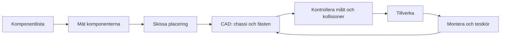

# Robotmopp

## Syfte

Robotmoppen är Driverbot 2.0: en ESP8266-bil som styrs från ROS2 på datorn via en MQTT-brygga. Uppdraget är att täcka en arena på 2 × 2 m med en whiteboardpenna under bilen. Projektet delas med kurserna Teknik nivå 2 och Teknik specialisering nivå 1 (Smarta system). **I Konstruktion nivå 1 fokuserar du på chassits konstruktion**: projektplanen, komponentlistan, CAD-modellen av chassit och hur allt monteras ihop till en bil som fungerar.

## Koppling till kursen

**Kriterier i vanliga ord.** Du visar att du

- följer konstruktionsprocessen från plan till CAD och färdig bil och förstår hur stegen hänger ihop
- följer standarder och normer och använder verktygen skickligt

**Centralt innehåll** som projektet behandlar: konstruktionsprocessen, val av komponenter, ritteknik och cad, prototyptillverkning, och provning genom mätning, simulering och test.

**Kapitel som förbereder**

- [Kapitel 3: CAD i Onshape](../../kapitel/03-cad-i-onshape.md)
- [Kapitel 4: Ritningar, standarder och normer](../../kapitel/04-ritningar-standarder.md)
- [Kapitel 9: Vridning och överföring av effekt](../../kapitel/09-vridning-effekt.md), avsnittet om drivaxeln
- [Kapitel 10: Prototyp, komponenter, provning och dokumentation](../../kapitel/10-prototyp-komponenter-dokumentation.md)

## Vad du ska göra

- Gör en projektplan med komponentlista (bland annat ultraljudssensor HC-SR04 och ljussensor).
- Cadda ett chassi med fästen för penna och sensorer, och sätt ihop bilen.
- Testa städprogrammet i simulering (labb 8), koppla bilen till ROS2 (labb 9) och kör autonomt (labb 10).
- **Nivå 1:** styr bilen manuellt från ROS2 och berör alla 64 rutor.
- **Nivå 2:** hinderstopp och autonom slumpstädning med mätt täckning.
- **Nivå 3:** spiral eller "undvik ritat" med ljussensorn, jämfört med slump.

Arenan delas in i ett rutnät med 8 × 8 rutor (25 cm) så att du kan mäta hur stor del av ytan bilen har städat.

## Chassit i den här kursen

Det här är den del av projektet som framför allt hör till konstruktionskursen. Chassit ska ha plats för och hålla fast

| Del | Att tänka på |
|---|---|
| ESP8266 | Åtkomst till USB-kontakten och kablarna. Fäst så att den inte kan släppa |
| Motor (TT-motor) | Hållare som tar upp kraften från drivningen |
| Styrservo | Bilen svänger med servot, så hjulen behöver utrymme att vrida sig |
| Ultraljudssensor HC-SR04 | Fram på bilen med fri sikt framåt, så att väggen ses och inte det egna chassit |
| Ljussensor | Riktad mot golvet för att skilja pennspår från oritat papper |
| Whiteboardpenna | Under bilens mitt, med spetsen mot golvet och lite fjädring |

Mät dina komponenter och kontrollera måtten mot komponentlistan innan du tillverkar. Presentationen nämner att bilen på nivå 3 ska rymmas inom 150 × 150 × 150 mm. Fråga din lärare vilka mått som gäller.

Eftersom bilen inte kan svänga på stället påverkar pennans placering vilken yta som täcks. Ett [sensorfäste har räknats igenom i kapitel 10](../../kapitel/10-prototyp-komponenter-dokumentation.md): det är inte tyngden som är problemet, utan stötar och vibrationer.

### Så kan du arbeta med chassit

## Krav och leverabler

Utifrån projektbeskrivningen ska du ta fram:

- en projektplan med komponentlista
- ett CAD-modellerat chassi med fästen för penna och sensorer
- en ihopsatt bil

Projektet avslutas med demo på robotbanan. Programmeringsdelen och nivåerna 1–3 hör samman med de andra kurserna som delar projektet.

## Arbetsgång

| Lektion | Innehåll |
|---|---|
| 1 | Projektstart: genomgång av Driverbot 2.0 och robotmoppen (arena, rutnät, nivå 1–3). Bli klar med turtlesim-labbarna till och med labb 7. |
| 2 | Projektplan: gör komponentlista (ESP8266, motor, servo, HC-SR04, ljussensor, penna) och skissa chassit. |
| 3 | CAD: börja modellera chassit med plats för motor, servo och ESP8266. |
| 4 | CAD fortsättning: fästen för whiteboardpenna, ultraljudssensor och ljussensor. Kontrollera måtten mot komponentlistan. |
| 5 | Labb 8 del 1–2: täckningsmätar-noden (8×8 rutnät) och manuell städning med teleop i turtlesim. |
| 6 | Labb 8 del 3–4: autonom städare med tillståndsmaskinen KOR_FRAMAT/BACKA_SVANG och launch-fil. Jämför manuell och autonom täckning. |
| 7 | Labb 9 del 1–2: ladda upp ny firmware på ESP8266 och testa bilen via MQTT utan ROS2. |
| 8 | Labb 9 del 3–4: bryggnoden ROS2–MQTT. Kör bilen med teleop och läs av ultraljudssensorn i ROS2. |
| 9 | Sätt ihop robotmoppen: montera chassit, pennan och sensorerna på bilen och testkör. |
| 10 | Nivå 1 på arenan: kalibrera bilen, styr manuellt från ROS2 och försök beröra alla 64 rutor. Börja på hinderstoppet i labb 10. |
| 11 | Labb 10: hinderstopp, hinder-undvikare och autonom slumpstädning på arenan. Mät täckningen i rutnätet (nivå 2). |
| 12 | Nivå 3: spiral eller "undvik ritat" med ljussensorn, jämför med slump. Trimma och dokumentera resultaten inför demon. |

## Bedömning

Du bedöms på hur väl du använder ROS2 och verktygen, hur systematiskt du utvecklar och testar lösningen, hur du följer konstruktionsprocessen från plan till CAD och färdig bil, och hur du dokumenterar, presenterar och utvärderar resultatet. Projektet avslutas med demo på robotbanan.

## Material

- [ROS2-repot med labbar och presentationen om Driverbot 2.0](https://github.com/abbjetmus/ROS2)
- [Labb 8: Robotmoppen i simulering](https://github.com/abbjetmus/ROS2/blob/main/labs/labb-8-robotmopp-simulering.md)
- [Labb 9: Koppla bilen](https://github.com/abbjetmus/ROS2/blob/main/labs/labb-9-koppla-bilen.md)
- [Labb 10: Autonom bil](https://github.com/abbjetmus/ROS2/blob/main/labs/labb-10-autonom-bil.md)

## Tips

- Mät dina egna komponenter med skjutmått innan du bestämmer mått i CAD.
- Gör en sammanställning i Onshape med enkla modeller av komponenterna för att se om allt får plats.
- Provkör chassit med hjulen i luften första gången.
- Skriv ner vilka lösningar du ändrade och varför. Den ändringslistan är en del av dokumentationen.
